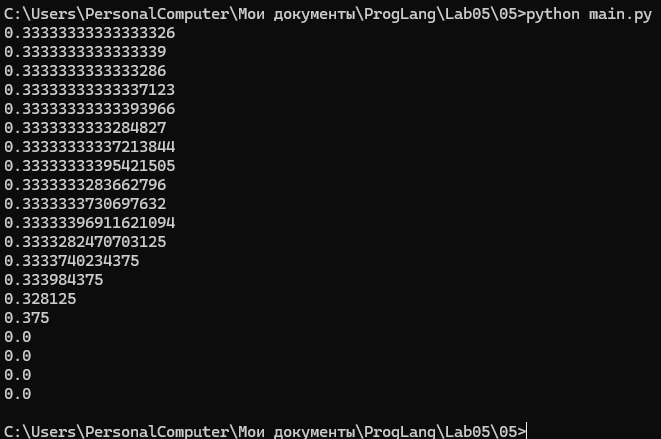
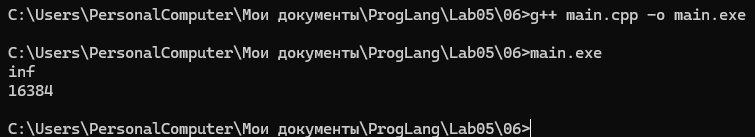
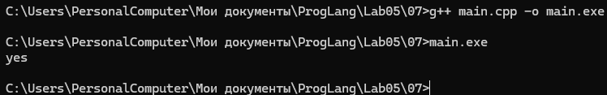
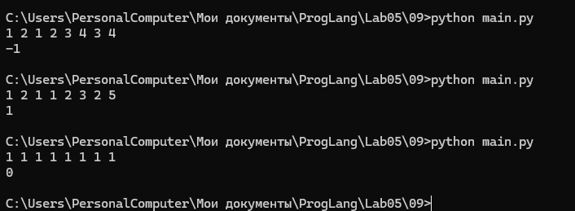

# Языки программирования
## Лабораторная работа 5

### Задание 1 **(2)**
*Переведите в двоичную запись два произвольных рациональных числа (числа вида* $\frac{p}{q}$).
*У одного из чисел знаменатель должен быть степенью двойки (32), а у другого --- некоторым числом
от 9 до 12.*

*Запись второго числа будет содержать период. Его надо найти. При решении задачи нельзя 
использовать вычислительную технику. Процесс решения должен быть представлен в отчете.*

#### Решение

Выберем `13/32` и `5/11`. Для перевода дробной части последовательно умножаем её на 2. Целая часть результата становится очередным двоичным разрядом, а дробная используется на следующем шаге.

##### Число 13/32

| Шаг | Умножение остатка на 2 | Разряд | Новый остаток |
|---|---|---|---|
| 1 | 26/32 | 0 | 26/32 |
| 2 | 52/32 = 1 + 20/32 | 1 | 20/32 |
| 3 | 40/32 = 1 + 8/32 | 1 | 8/32 |
| 4 | 16/32 | 0 | 16/32 |
| 5 | 32/32 = 1 | 1 | 0 |

**Ответ:** `(13/32)₁₀ = (0.01101)₂`.

Проверка: `1/4 + 1/8 + 1/32 = (8 + 4 + 1)/32 = 13/32`. Запись конечная, поскольку знаменатель равен `2⁵`.

##### Число 5/11

| Шаг | Умножение остатка на 2 | Разряд | Новый остаток |
|---|---|---|---|
| 1 | 10/11 | 0 | 10/11 |
| 2 | 20/11 | 1 | 9/11 |
| 3 | 18/11 | 1 | 7/11 |
| 4 | 14/11 | 1 | 3/11 |
| 5 | 6/11 | 0 | 6/11 |
| 6 | 12/11 | 1 | 1/11 |
| 7 | 2/11 | 0 | 2/11 |
| 8 | 4/11 | 0 | 4/11 |
| 9 | 8/11 | 0 | 8/11 |
| 10 | 16/11 | 1 | 5/11 |

После десятого шага вернулись к исходному остатку. Поэтому повторяется блок `0111010001`. Раньше остатки не повторялись, значит минимальная длина периода — 10.

**Ответ:** `(5/11)10 = (0.(0111010001))2`.

Проверка через геометрическую прогрессию: двоичный блок `0111010001` равен `465`, поэтому дробь равна `465/(2^10 − 1) = 465/1023 = 5/11`.

### Задание 2 **(3)**
*Переведите в двоичную запись и найдите машинное представление в типе* **double**
*для произвольного вещественного числа большего, чем 100 с одним знаком после точки, например
для* $113.7$. *Цифра после точки не должна быть нулем иля пятеркой.*

*При решении задачи нельзя 
использовать вычислительную технику. Процесс решения должен быть представлен в отчете.*

#### Решение

##### Перевод целой части

| Деление | Частное | Остаток |
|---|---|---|
| 113 / 2 | 56 | 1 |
| 56 / 2 | 28 | 0 |
| 28 / 2 | 14 | 0 |
| 14 / 2 | 7 | 0 |
| 7 / 2 | 3 | 1 |
| 3 / 2 | 1 | 1 |
| 1 / 2 | 0 | 1 |

Читаем остатки снизу вверх: `113(10) = 1110001(2)`.

##### Перевод дробной части

`0.7 × 2 = 1.4` → разряд 1, остаток 0.4.

`0.4 × 2 = 0.8` → разряд 0, остаток 0.8.

`0.8 × 2 = 1.6` → разряд 1, остаток 0.6.

`0.6 × 2 = 1.2` → разряд 1, остаток 0.2.

`0.2 × 2 = 0.4` → разряд 0, остаток 0.4.

Остаток 0.4 повторился. Следовательно, `0.7(10) = 0.1(0110)2`.

Получаем `113.7(10) = 1110001.1(0110)2 = 1.1100011(0110)2 × 2^6`.

##### Поля double

В IEEE 754 binary64 один бит занимает знак, 11 — порядок, 52 — дробная часть мантиссы. Ведущая единица нормализованной мантиссы подразумевается.

- Знак: `0`, поскольку число положительное.
- Порядок: `p = 6`.
- Смещённый порядок: `6 + 1023 = 1029 = 10000000101(2)`.
- Дробные биты: сначала `1100011`, затем повторяется `0110`.

Первые 52 дробных бита до округления:

```text
1100011011001100110011001100110011001100110011001100
```

Для ручного подсчёта: это 7 начальных битов, 11 полных блоков по 4 бита и ещё один бит: `7 + 11×4 + 1 = 52`. Следующий, 53-й бит равен 1, а дальше есть ненулевые биты. 
Отброшенная часть больше половины шага, поэтому округляем вверх и увеличиваем последние сохранённые биты на 1.

**Машинное представление:**

```text
знак  порядок      дробная часть мантиссы
0     10000000101  1100011011001100110011001100110011001100110011001101
```

Шестнадцатеричная запись: `0x405C6CCCCCCCCCCD`.

Сохранённое значение равно приблизительно `113.70000000000000284217`. Число 113.7 не представляется точно, поскольку его двоичная дробь бесконечна.

### Задание 3 **(3)**
*Найдите сумму и произведение для записанных далее пар чисел. Числа заданы в двоичной записи 
в экспоненциальном виде. Ответ необходимо записать в нормализованннои экспоненциальном виде.*

* 1.0011e18 и $1.1001e21;
* 1.1011e-25 и, $1.1101e-23;
* 1.1011e-3 и $1.1011e1.
  
*При решении задачи нельзя 
использовать вычислительную технику. Процесс решения должен быть представлен в отчете.*

#### Решение

Здесь `e k` означает умножение на `2ᵏ`. В ответе мантисса должна находиться в диапазоне `[1; 2)`. Ограничение длины мантиссы в задании не задано, поэтому ответы точные, без округления.

##### а) 1.0011 × 2¹⁸ и 1.1001 × 2²¹

Для суммы приводим оба числа к порядку 21:

```text
1.0011 × 2¹⁸ = 0.0010011 × 2²¹

  1.1001000
+ 0.0010011
-----------
  1.1011011
```

**Сумма:** `1.1011011₂ × 2²¹`.

При умножении складываем порядки: `18 + 21 = 39`. Для произведения мантисс временно убираем точки. У каждой мантиссы четыре дробных бита, у произведения их будет восемь.

```text
10011 × 11001:
       10011
    10011000
   100110000
-----------
  111011011
```

Возвращаем точку: `1.11011011`.

**Произведение:** `1.11011011(2) × 2^39`.

##### б) 1.1011 × 2^-25 и 1.1101 × 2^-23

Для суммы приводим порядок к −23:

```text
1.1011 × 2^-25 = 0.011011 × 2^-23

  1.110100
+ 0.011011
----------
 10.001111                     
```

Нормализуем: `10.001111 × 2%-23 = 1.0001111 × 2^-22`.

**Сумма:** `1.0001111(2) × 2^-22`.

Произведение целых записей мантисс:

```text
11011 × 11101:
        11011
      1101100
     11011000
    110110000
------------
   1100001111
```

После восстановления восьми дробных разрядов: `11.00001111`. Порядки дают `−25 − 23 = −48`. При нормализации порядок увеличивается на 1.

**Произведение:** `1.100001111(2) × 2^-47`.

##### в) 1.1011 × 2^-3 и 1.1011 × 2^1

```text
1.1011 × 2^-3 = 0.00011011 × 2^3

  1.10110000
+ 0.00011011
------------
  1.11001011
```

**Сумма:** `1.11001011(2) × 2^1`.

```text
11011 × 11011:
        11011
       110110
     11011000
    110110000
------------
   1011011001
```

Возвращаем точку: `10.11011001`. Складываем порядки: `−3 + 1 = −2`. Нормализуем.

**Произведение:** `1.011011001(2) × 2^-1`.

### Задание 4 **(2)**

*Рассмотрим следующий пример в IDLE Python*
```
>>> x = 99.99
>>> int(x/10+0.001)
9
```
*Результат должен был быть равен 10, однако оказался другим. Почему так произошло?
Как исправить программу, чтобы она корректно переводила вещественные числа в целые?*

#### Решение

Математически выражение равно 10. Но 99.99 и 0.001 хранятся приближённо, и в обычном Python с binary64 вычисление даёт `9.999999999999998`. Функция `int` отбрасывает дробную часть, поэтому получается 9.

Если требуется округление до ближайшего целого:

```python
x = 99.99
answer = round(x / 10 + 0.001)
print(answer)  # 10
```

`round` в Python при точном попадании посередине выбирает ближайшее чётное целое. Если задача требует именно отбрасывания дробной части, заменять `int` на `round` нельзя: следует обеспечить точные исходные вычисления, например через `Decimal` из строки. Добавление произвольной константы не является универсальным исправлением погрешности.

### Задание 5. **(2)**

*Рассмотрите следующую программу. Объясните результаты ее работы. В частности,
как величина* $y$ *повлияла на ответ?*
```
x = 1/3
y = 1
for i in range(20):
    print((x+y)-y)
    y*=10
```
*В отчете требуется привести вычисления для оценки погрешности.*

#### Решение

Число `1/3` имеет бесконечную двоичную запись и хранится приближённо:

```text
x ≈ 0.3333333333333333
```

Тип `float` в Python обычно соответствует `double` и хранит 53 значащих двоичных разряда. Относительная точность составляет примерно:

```text
2^-52 ≈ 2.22 · 10^-16
```

Числа с плавающей точкой сохраняют примерно одинаковое количество значащих цифр. Когда `y` увеличивается, расстояние между соседними представимыми числами около `y` тоже увеличивается. 
При вычислении `x + y` младшие разряды числа `x` начинают теряться.

В начале результат близок к `1/3`:

```text
y = 1:       0.33333333333333326
y = 1000:    0.33333333333337123
y = 1000000: 0.33333333337213844
```

Затем ошибка становится заметной:

```text
y = 1000000000000:    0.3333740234375
y = 100000000000000:  0.328125
y = 1000000000000000: 0.375
```

При `y = 10^16` расстояние между соседними значениями `double` около `y` уже равно `2`. Число `1/3` слишком мало, чтобы изменить `y`, поэтому:

```text
x + y = y
(x + y) - y = 0
```

Начиная с этого момента программа выводит нули.

Абсолютную ошибку сложения можно приблизительно оценить величиной порядка:

```text
y · 2^-52
```

Чем больше `y`, тем больше эта ошибка. Последующее вычитание двух близких больших чисел уничтожает общие старшие разряды и оставляет только накопленную ошибку. Такое явление называется катастрофической потерей точности.



### Задание 6 **(2)**

*Для какого минимального значения* $n$ *программа на С++ выведет* **inf**? *Объясните
ответ.* *Что произойдет, если тип* **double** *заменить на* **long double**?
```
int n=...;
double s = pow(2, n);
std::cout << std::fixed << s << std::endl;
```

#### Решение

Для обычного `double` IEEE 754 binary64 максимальное конечное число равно `(2 − 2⁻⁵²) × 2¹⁰²³`.

`2¹⁰²³` ещё представимо, а `2¹⁰²⁴` выходит за диапазон. При стандартном округлении к ближайшему и обычной реализации `pow` минимальное значение — **n = 1024**. Манипулятор `fixed` влияет только на формат вывода, а не на диапазон.

##### Что изменится при long double

В исходной записи `pow(2, n)` оба аргумента целочисленные; стандартная перегрузка вычисляет результат как `double`. Простая замена переменной на `long double` не увеличивает диапазон вычисления: уже полученная бесконечность будет преобразована в `long double`.

Нужно изменить и тип аргумента:

```cpp
#include <cmath>
#include <iostream>
#include <limits>

int main() {
    int n = 16384;
    long double s = std::pow(2.0L, n);
    std::cout << std::fixed << s << '\n';
    std::cout << std::numeric_limits<long double>::max_exponent << '\n';
}
```

Для распространённого 80-битного расширенного формата и binary128 граница — `n = 16384`. Если `long double` совпадает с `double`, граница останется 1024.
 Для двоичного типа границу можно узнать через `max_exponent`. Конкретный ответ зависит от реализации, режима округления и настроек обработки переполнения.


### Задание 7 **(2)**

*Допишите что-либо вместо многоточия программе на С++, чтобы программа при запуске выдавала ответ* **yes**.
```
double s = ...;
if (s != s)
  std::cout << "yes";
```

#### Решение

Нужно записать в `s` значение NaN: оно не равно самому себе.

```cpp
#include <iostream>
#include <limits>

int main() {
    double s = std::numeric_limits<double>::quiet_NaN();
    if (s != s)
        std::cout << "yes";
}
```

Для обычного IEEE 754 double условие истинно. Это свойство NaN, а не обычных конечных чисел или бесконечности. 
Компиляция с допущением отсутствия NaN, например отдельными режимами fast-math, может изменить поведение.


### Задание 8 **(2)**

*Какое минимальное натуральное число при преобразовании в тип* **double** *записывается с погрешностью? Объясните
ответ. Почему следующее за ним число уже выводится без погрешности?*

#### Решение

В double имеется 53 значащих двоичных разряда: 52 сохранённых и одна подразумеваемая единица. Все целые от 0 до `2⁵³` включительно представимы точно.

**Первое неточное число:** `2⁵³ + 1 = 9007199254740993`.

В диапазоне `[2⁵³; 2⁵⁴)` шаг равен 2. Нечётное `2⁵³+1` находится между двумя представимыми числами. При округлении к ближайшему с выбором чётной мантиссы оно округляется до `2⁵³ = 9007199254740992`.

Следующее число `2⁵³+2 = 9007199254740994` чётное и попадает в сетку с шагом 2, поэтому хранится точно. Для демонстрации вывода нужно задать достаточную точность, 
иначе форматирование само может скрыть различие.

###  Задание 9 **(2)**
*Напишите программу для решения следующей задачи.*

*Даны четыре рациональных числа. (Рациональное число - это число вида*
$\frac{p}{q}$, *где* $p$ *и* $q$ - *целые числа.) Напишите программу, которая сравнит сумму
двух первых чисел с суммой двух последних чисел. Программа должна выводить* $1$, $0$ *или* $-1$
*в зависимости от результатов сравнения. Решение можно проверить в проверяющей системе*
[http://olymp3.isu.ru/cgi-bin/new-client?contest_id=102](http://olymp3.isu.ru/cgi-bin/new-client?contest_id=102), *задача 03*.

#### Решение

Пусть вход содержит восемь целых: `p1 q1 p2 q2 p3 q3 p4 q4`. Знаменатели должны быть ненулевыми. Если формат ввода в проверяющей системе отличается, меняется только чтение данных.

Для первых двух дробей:

`a/b = (p1×q2 + p2×q1)/(q1×q2)`.

Для последних двух:

`c/d = (p3×q4 + p4×q3)/(q3×q4)`.

Сначала делаем знаменатели положительными. Тогда сравнить `a/b` и `c/d` можно по знаку `a×d − c×b`, не выполняя деление.

```python
data = []
while len(data)<8:
    data.extend(map(int, input().split()))
p1, q1, p2, q2, p3, q3, p4, q4 = data
if q1 < 0:
    p1, q1 = -p1, -q1
if q2 < 0:
    p2, q2 = -p2, -q2
if q3 < 0:
    p3, q3 = -p3, -q3
if q4 < 0:
    p4, q4 = -p4, -q4

left = (p1 * q2 + p2 * q1) * q3 * q4
right = (p3 * q4 + p4 * q3) * q1 * q2
if left > right:
    print(1)
elif left < right:
    print(-1)
else:
    print(0)
```

Вывод: `1`, если первая сумма больше; `0`, если равны; `−1`, если первая меньше. Python использует целые произвольной длины, поэтому здесь нет ни погрешности float, ни переполнения фиксированного целого типа.

Пример: `1 2 1 3 2 3 1 6` → `0`, поскольку обе суммы равны `5/6`.




