# Языки программирования
## Лабораторная работа 7

### Задание 1 **(2)**
*Оцените работу следующих фрагментов программ. Какие из них обладают неоднозначным поведением? Почему?*
```
int x=10, y=3;
std::cout << std::min(x=15, x+y);
```

функция std::min() принимает два аргумента, порядок вычисления которых не определён. Если сначала выполняется x = 15, 
второй аргумент получает значение 18, и минимум равен 15. Если сначала выполняется x + y, второй аргумент равен 13 и минимум составляет 13.

```
int x=10, y=3;
x=15, y+=x, x+=y;
```
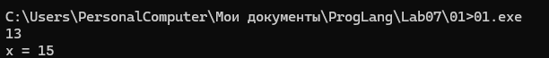

оператор запятая гарантирует последовательное выполнение выражений слева направо.

Сначала x = 15, затем y = 3 + 15 = 18, после этого x = 15 + 18 = 33. Неоднозначности нет.

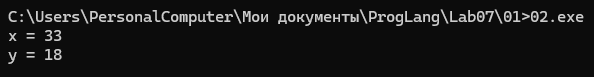

```
int x=10, y=9;
if (x>y++ && y++>9)
  cout << "yes" << endl;
cout << y;
```

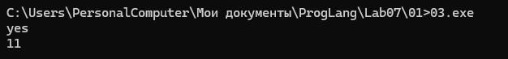

при проверке первого условия сравниваются 10 и 9. После сравнения переменная y увеличивается до 10. Поскольку условие истинно, выполняется вторая проверка: 10 > 9. Она тоже истинна, и y увеличивается до 11.

Оператор && обеспечивает порядок вычисления слева направо, поэтому результат однозначен.

*Тексты программ разместите в папке с номером задания*

### Задание 2 **(2)**
*Как записать следующие строки программы на С++ в виде одного
выражения? Приведите несколько способов, в том числе с использованием операторов инкремента.*
*Проверьте работу написанных программ*
```
x=x+1;
z=z+2*x+3*y;
y=y+1;
```

в исходной программе сначала увеличивается x, затем вычисляется новое значение z, после чего увеличивается y.
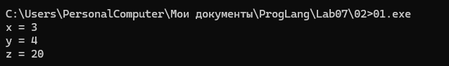


```

#include <iostream>

int main() {
    int x = 2, y = 3, z = 5;

    x += 1, z += 2 * x + 3 * y, y += 1;

    std::cout << "x = " << x << '\n';
    std::cout << "y = " << y << '\n';
    std::cout << "z = " << z << '\n';

    return 0;
}

```
Второй вариант использует оператор запятая, который сохраняет последовательность операций.
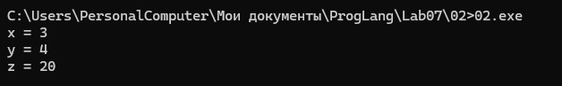

```

#include <iostream>

int main() {
    int x = 2, y = 3, z = 5;

    z += 2 * ++x + 3 * y++;

    std::cout << "x = " << x << '\n';
    std::cout << "y = " << y << '\n';
    std::cout << "z = " << z << '\n';

    return 0;
}

```
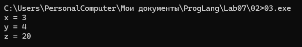

В третьем варианте ++x увеличивает x до вычисления произведения, а y++ использует старое значение y и затем увеличивает его. В результате:
z=5+2*3+3*3=20

*Тексты программ разместите в папке с номером задания*

### Задание 3 **(2)**
*Рассмотрите следующий фрагмент программы. Он заполняет вектор из 10 элементов единицами.*
```
std::vector<int> x(10);
for (int i = 0; i < 10;)
   x[i++] = 1;
```
*Перепишите ее так, чтобы в третьей строке использовался префиксный инкремент, но результат ее работы не изменился.*
```
std::vector<int> x(10);
for (...)
   x[++i]=1;
```

постфиксный инкремент сначала возвращает старое значение переменной, а затем увеличивает его. Префиксный инкремент сначала увеличивает переменную, после чего возвращает новое значение.

Поэтому начальное значение счётчика изменено с 0 на -1. При первой итерации ++i увеличивает счётчик до 0, что соответствует первому элементу вектора. На последней итерации индекс становится равным 9.

### Задание 4 **(2)**

*Почему присваивание* ```(++x)=y``` *является синтаксически правильным, а*
```(x++)=y``` - *нет? Запишите текст сообщения об ошибке, переведите и объясните его.*

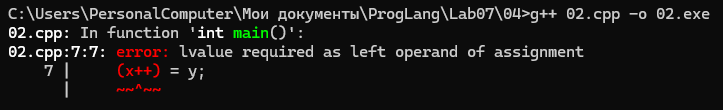
error: lvalue required as left operand of assignment
Перевод: «В качестве левого операнда присваивания требуется lvalue».
результат постфиксного инкремента x++ относится к категории prvalue. 
Он представляет старое значение переменной, а не саму переменную, поэтому не может использоваться слева от оператора присваивания.
различие заключается в категории возвращаемого значения. Префиксный инкремент возвращает lvalue, постфиксный — prvalue.

### Задание 5 **(2)**

*Программисты на Python для обмена значений двух переменных часто пишут строку*
```
a,b = b,a
```
*Проверьте, будет ли аналогичная строка на С++ (с точкой с запятой в конце) являться синтаксически
правильной? Будет ли она обменивать значения переменных? Как в языке С++ вычисляется это выражение?*

в C++ выражение a, b = b, a является синтаксически правильным, но не выполняет обмен значениями.

Оператор присваивания имеет более высокий приоритет, чем оператор запятая. Поэтому выражение группируется так:
(a), (b = b), (a);


Сначала вычисляется a, затем выполняется присваивание b = b, после чего снова вычисляется a. Ни одна переменная не изменяется.

Для правильного обмена можно использовать std::swap(a, b).

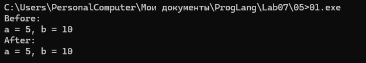

### Задание 6 **(2)**

*Проверьте работу следующего фрагмента программы*
```
  std::string s;
  for (int i=0; i<1000000; i++)
     s += 'a';
  std::cout << s.size();
```
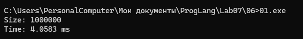

*Измените третью строку на*
```
s=s+'a';
```
*Изменится ли что-нибудь в ее работе? Объясните результат.*

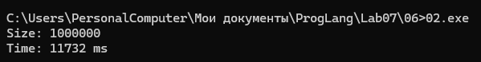

обе программы создают строку длиной 1 000 000 символов. Разница заключается в способе изменения строки.

Оператор += добавляет символ непосредственно к существующей строке. 
Оператор + формирует новый строковый результат, который затем присваивается переменной s. Во втором случае обычно возникают дополнительные выделения памяти и копирования содержимого строки.

Из-за этого второй способ, как правило, работает медленнее. Разница особенно заметна при большом количестве повторений.


### Задание 7 **(2)**

*Как работает следующая программа? Как зависит результат от исходного значения?*
```
int x;
std::cin >> x;
x-->0 && x-->0 && x-->0 && x-->0 && x-->0;
std::cout << x;
```
оператор && обеспечивает вычисление условий слева направо. Если условие ложно, следующие операнды не вычисляются. 
Постфиксный декремент уменьшает переменную независимо от результата сравнения, если соответствующее выражение было вычислено.
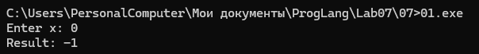
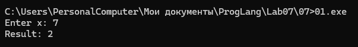
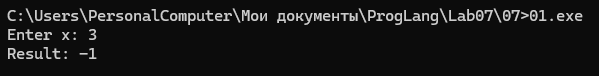

### Задание 8 **(3)**

*Какое число выводит следующий фрагмент программы? Посчитайте результат без использования
вычислительной техники. Отчет должен содержать процесс вычислений.*
```
int s = 0;
for (int i = 0, j = 5;i+j <= 16;(i<j ? i : j)++)
   (s += i) += j;
std::cout << s;
```
Таблица вычислений
№	i	j	i + j	s
1	0	5	5	5
2	1	5	6	11
3	2	5	7	18
4	3	5	8	26
5	4	5	9	35
6	5	5	10	45
7	5	6	11	56
8	6	6	12	68
9	6	7	13	81
10	7	7	14	95
11	7	8	15	110
12	8	8	16	126

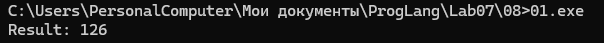

###  Задание 9 **(3)**
*Рассмотрите следующую программу. Предполагается, что на вход подается некоторый
индекс в массиве - число от нуля до девяти и значение, которое надо записать по этому индексу.*
```
int i = 0;
std::vector<int> x(10);
std::cin >> i >> x[i];
std::cout << x[i];
```
*Проверьте работу этой программы на различных компиляторах. Найдите два компилятора (можно 
проверить онлайн компиляторы), на которых эта программа будет давать различные ответы при одинаковом
вводе. Как это объяснить?*

# Практикум Python 3

## Задание 1

```python
n = int(input())

classes = (n + 24) // 25
students = n // classes

print(classes, students)
```

## Задание 2

```python
t = int(input())

for i in range(t):
    n = int(input())
    p, q = map(int, input().split())

    result = "0."

    for j in range(n):
        p *= 2
        result += str(p // q)
        p %= q

    print(result)
```

## Задание 3

```python
t = int(input())
results = []

for i in range(t):
    a, b, c, d, e, f, g, h = map(int, input().split())

    first = a * d * f * h + c * b * f * h
    second = e * b * d * h + g * b * d * f

    if first < second:
        results.append(-1)
    elif first > second:
        results.append(1)
    else:
        results.append(0)

print(*results)
```

## Задание 4

```python
n = int(input())
numbers = list(map(int, input().split()))

result = ""

for x in numbers:
    binary_x = bin(x)[2:]
    y = len(binary_x)
    binary_y = bin(y)[2:]
    z = len(binary_y)

    code = "0" * (z - 1) + binary_y + binary_x[1:]
    result += code

print(result)
```

## Задание 5

```python
s = input()
i = 0
numbers = []

while i < len(s):
    zeros = 0

    while s[i] == '0':
        zeros += 1
        i += 1

    z = zeros + 1
    y = int(s[i:i + z], 2)
    i += z

    x = int('1' + s[i:i + y - 1], 2)
    i += y - 1

    numbers.append(x)

print(len(numbers))
print(*numbers)
```